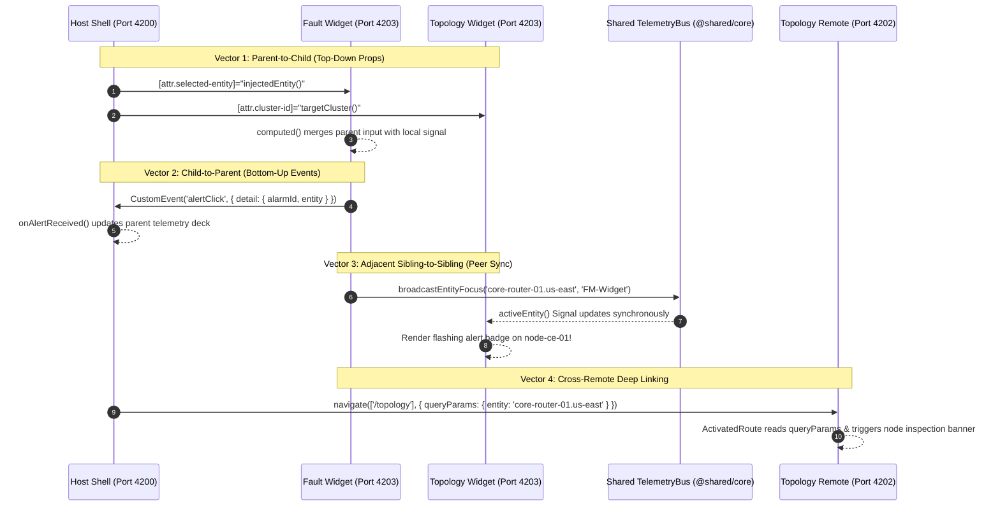

# 🏗️ Angular 22 Microfrontend Architecture: Complete Deep Dive Guide

Author: **Ashutosh Choubey (Principal Frontend & Cloud Architect)**  
Publication: **WorldGyan Next-Gen Engineering (`worldgyan.com`)**  
Target Framework: **Angular 22+ (Zoneless, Signals, Native Federation, Angular Elements, Express API)**

---

## 📋 Table of Contents
1. [Executive Summary & Motivation](#1-executive-summary--motivation)
2. [Architectural Topologies: Webpack vs Native Federation](#2-architectural-topologies-webpack-vs-native-federation)
3. [The Enterprise Multi-Project Workspace Topology](#3-the-enterprise-multi-project-workspace-topology)
4. [Native Federation & The es-module-shims Invariant](#4-native-federation--the-es-module-shims-invariant)
5. [Singleton State Engine (`@shared/core`) & Multi-Injector Signal Anchor](#5-singleton-state-engine-sharedcore--multi-injector-signal-anchor)
6. [Comprehensive Bidirectional Data Passing Architecture](#6-comprehensive-bidirectional-data-passing-architecture)
   - [Vector 1: Parent-to-Child (Host Shell ➜ Web Components)](#vector-1-parent-to-child-host-shell--web-components)
   - [Vector 2: Child-to-Parent (Web Components ➜ Host Shell)](#vector-2-child-to-parent-web-components--host-shell)
   - [Vector 3: Adjacent Sibling-to-Sibling (Peer Microfrontend Sync)](#vector-3-adjacent-sibling-to-sibling-peer-microfrontend-sync)
   - [Vector 4: Cross-Remote Deep Linking (Routed MFE Navigation)](#vector-4-cross-remote-deep-linking-routed-mfe-navigation)
7. [Host Shell Architecture (`gui-aggregator-service`)](#7-host-shell-architecture-gui-aggregator-service)
8. [Routed Remote Applications (`fault-management` & `topology-manager`)](#8-routed-remote-applications-fault-management--topology-manager)
9. [Autonomous Web Components (`dashboard-widgets`)](#9-autonomous-web-components-dashboard-widgets)
10. [Zoneless Reactivity & Signal Integration](#10-zoneless-reactivity--signal-integration)
11. [Error Boundaries, Fallbacks & Offline Resilience](#11-error-boundaries-fallbacks--offline-resilience)
12. [Step-by-Step Production Deployment Playbook](#12-step-by-step-production-deployment-playbook)
13. [Principal Architect Interview Q&A Deep Dive](#13-principal-architect-interview-qa-deep-dive)

---

## 1. Executive Summary & Motivation

Enterprise frontends frequently encounter severe operational bottlenecks as software organizations scale beyond 50+ engineers across multiple autonomous domain squads:
- **Coupled Deployment Cadence:** A regression in one domain (e.g. topology visualization) halts or delays production deployments for completely unrelated business features (e.g. telecom alarm triage).
- **Build-Time Scaling Degeneracy:** As single-page monorepos exceed hundreds of thousands of lines of TypeScript, CI build times and local hot-reload latency degrade exponentially.
- **Dependency & Version Lockstep:** Upgrading Angular versions, component design systems, or telemetry utilities requires lockstep coordination across dozens of teams, stalling innovation.

This architectural guide provides a battle-tested blueprint for a distributed, resilient, and high-performance microfrontend system built on **Angular 22+**, utilizing modern web standards:
- **Zoneless Runtime (`provideZonelessChangeDetection`):** Surgical $O(1)$ change detection driven by Angular Signals, eliminating Zone.js monkey-patching overhead.
- **Native Federation (`@angular-architects/native-federation`):** Native browser ECMAScript Modules (ESM) and dynamic Import Maps, completely eliminating Webpack 5 runtime lock-in.
- **Angular Elements (`@angular/elements`):** Autonomous W3C Custom Elements for composite dashboard widgets embedded side-by-side.
- **Bidirectional Telemetry & State Bus:** Real-time synchronization spanning Parent-to-Child, Child-to-Parent, and Adjacent Sibling-to-Sibling microfrontends.

---

## 2. Architectural Topologies: Webpack vs Native Federation

```
+---------------------------------------------------------------------------------------+
|                            LEGACY WEBPACK MODULE FEDERATION                           |
|  [Source Code] --> [Webpack 5 Bundler] --> [window.webpackChunk Runtime] --> [DOM]    |
|  Drawbacks: Incompatible with modern esbuild / Vite; heavyweight global runtime       |
+---------------------------------------------------------------------------------------+

+---------------------------------------------------------------------------------------+
|                        MODERN NATIVE FEDERATION (ANGULAR 22+)                         |
|  [Source Code] --> [esbuild / Vite Application Builder] --> [Browser ESM] --> [DOM]   |
|  Advantages: Web standard browser Import Maps, 10x faster builds, zero bundler lock-in|
+---------------------------------------------------------------------------------------+
```

### Critical Architectural Distinctions

| Characteristic | Webpack 5 Module Federation | Native Federation (`@angular-architects`) |
| :--- | :--- | :--- |
| **Build Engine** | Webpack 5 strictly (slow cold starts) | **`@angular/build:application` (Vite dev, esbuild prod)** |
| **Module Resolution** | Webpack custom chunk loader (`jsonpScript`) | **Native Browser ECMAScript Modules (`import()`)** |
| **Dependency Sharing** | Webpack runtime shared scope array | **Browser Import Maps (`<script type="importmap">`)** |
| **Angular Compatibility** | Angular 12 – 16 (Webpack) | **Angular 17 – 22+ (Modern Application Builder)** |
| **Browser Execution** | Requires Webpack bootstrapping wrapper | Uses native browser module-shims (`es-module-shims`) |
| **HMR Latency** | 2,500ms – 6,000ms on large repos | **Sub-50ms via Vite dev server** |
| **Memory Footprint** | Moderate (Webpack bundle wrappers) | **Minimal (pure native browser imports)** |

Native Federation integrates directly with Angular's modern Application Builder without requiring custom Webpack configs or ejecting Angular CLI settings.

---

## 3. The Enterprise Multi-Project Workspace Topology

The reference implementation is structured into decoupled applications sharing a common telemetry engine and mock backend:

```
microfrontends/workspace/
├── angular.json                       # Multi-project Angular 22 workspace configuration
├── tsconfig.json                      # Workspace TypeScript configuration
├── package.json                       # Root dependencies (Angular 22, Native Federation)
├── backend-mock/                      # Express Telemetry Mock API (Port 3000)
│   ├── package.json
│   └── src/server.ts                  # Multi-origin CORS, JWT Auth, Faults & Topology REST
├── projects/
│   └── shared-core/                   # Shared Singleton Engine (@shared/core)
│       └── src/
│           ├── services/
│           │   ├── auth.service.ts    # Signal-based Auth & RBAC State
│           │   ├── settings.service.ts# Theme & Locale sync with DOM root attributes
│           │   └── telemetry-bus.service.ts # Cross-MFE bidirectional reactive event bus
│           └── index.ts               # Barrel exports
└── apps/
    ├── gui-aggregator-service/        # Host Shell Application (Port 4200)
    │   ├── src/
    │   │   ├── app/
    │   │   │   ├── components/
    │   │   │   │   ├── shell-header.component.ts # Navigation, Settings Gear, Auth Badge
    │   │   │   │   └── dashboard.component.ts    # Host Dashboard embedding Web Components
    │   │   │   ├── guards/auth.guard.ts          # Functional security guard for remote routes
    │   │   │   ├── app.config.ts                 # Zoneless, Router, Interceptor, Schemas
    │   │   │   └── app.routes.ts                 # Dynamic loadRemoteModule() routes
    │   │   ├── assets/federation.manifest.json   # Remote endpoint registry
    │   │   ├── federation.config.js              # Strict singleton sharing rules
    │   │   └── main.ts                           # initFederation() bootstrap
    ├── fault-management/              # Routed Remote MFE 1 (Port 4201)
    │   ├── src/app/fault-management/
    │   │   ├── fault-management.routes.ts        # Exposed route module
    │   │   └── fault-management-root.component.ts# Alarms grid, severity filters, deep-link
    │   └── federation.config.js                  # Exposes ./Module
    ├── topology-manager/              # Routed Remote MFE 2 (Port 4202)
    │   ├── src/app/topology-manager/
    │   │   ├── topology-manager.routes.ts        # Exposed route module
    │   │   └── topology-manager-root.component.ts# Cluster topologies, health metrics
    │   └── federation.config.js                  # Exposes ./Module
    └── dashboard-widgets/             # Angular Elements Producer (Port 4203)
        ├── src/
        │   ├── elements.ts                       # createCustomElement() registration
        │   └── widgets/
        │       ├── fm-status-widget.component.ts # <fm-status-widget> W3C Web Component
        │       └── topology-summary-widget.component.ts # <topology-summary-widget>
        └── federation.config.js                  # Exposes ./Widgets
```

---

## 4. Native Federation & The `es-module-shims` Invariant

### The Blank Screen Failure Mode
When deploying Native Federation with modern Angular 22 (`@angular/build:application`), Native Federation outputs entry scripts using:
```html
<script src="main.js" type="module-shim"></script>
```
Standard browser JavaScript engines recognize `type="module"` but do **not** natively recognize `type="module-shim"`. Without a shim polyfill, browsers silently ignore the script tag, resulting in a blank screen with zero console errors!

### The Architectural Invariant: Explicit Polyfills Mapping
To guarantee universal browser execution, `es-module-shims` must be included in the `polyfills` array in `angular.json` across all host and remote projects:

```json
{
  "projects": {
    "gui-aggregator-service": {
      "architect": {
        "build": {
          "builder": "@angular-architects/native-federation:build",
          "options": {
            "polyfills": ["es-module-shims"]
          }
        }
      }
    }
  }
}
```

When configured, the esbuild bundler produces `polyfills.js` containing `es-module-shims`. It loads first, patches the browser's dynamic import mechanism, evaluates the runtime Import Map generated by `initFederation()`, and executes `main.js` seamlessly.

---

## 5. Singleton State Engine (`@shared/core`) & Multi-Injector Signal Anchor

### The Multi-Injector Challenge
In a hybrid microfrontend architecture combining Routed Remotes and Angular Elements:
1. Routed Remotes (`fault-management`, `topology-manager`) share the Host Shell's root `EnvironmentInjector` when loaded via `loadRemoteModule()`.
2. Angular Elements Web Components (`<fm-status-widget>`, `<topology-summary-widget>`) are instantiated through `createApplication({ providers: [] })`, generating an **independent root injector hierarchy**.

If a service is simply marked `@Injectable({ providedIn: 'root' })`, two distinct instances of the service will be instantiated in memory: one inside the Shell's injector and one inside the Custom Elements injector!

### The Global Signal Anchor Solution
To guarantee $O(1)$ reactivity across disjoint injectors, the shared state in `TelemetryBusService` anchors its signal references to `window.__MFE_GLOBAL_TELEMETRY__`:

```typescript
// projects/shared-core/src/services/telemetry-bus.service.ts
import { Injectable, signal, WritableSignal } from '@angular/core';

interface GlobalTelemetryScope {
  activeEntity: WritableSignal<string | null>;
  activeCluster: WritableSignal<string | null>;
  eventAuditLog: WritableSignal<string[]>;
}

declare global {
  interface Window {
    __MFE_GLOBAL_TELEMETRY__?: GlobalTelemetryScope;
  }
}

@Injectable({ providedIn: 'root' })
export class TelemetryBusService {
  readonly activeEntity: WritableSignal<string | null>;
  readonly activeCluster: WritableSignal<string | null>;
  readonly eventAuditLog: WritableSignal<string[]>;

  constructor() {
    if (!window.__MFE_GLOBAL_TELEMETRY__) {
      window.__MFE_GLOBAL_TELEMETRY__ = {
        activeEntity: signal<string | null>('core-router-01.us-east'),
        activeCluster: signal<string | null>('cluster-core-east'),
        eventAuditLog: signal<string[]>([])
      };
    }
    this.activeEntity = window.__MFE_GLOBAL_TELEMETRY__.activeEntity;
    this.activeCluster = window.__MFE_GLOBAL_TELEMETRY__.activeCluster;
    this.eventAuditLog = window.__MFE_GLOBAL_TELEMETRY__.eventAuditLog;
  }

  broadcastEntityFocus(entity: string, source: string): void {
    this.activeEntity.set(entity);
    this.eventAuditLog.update(log => [
      `[${new Date().toISOString().substring(11, 19)}] Sibling Sync from ${source}: Focus ${entity}`,
      ...log.slice(0, 9)
    ]);
  }
}
```

This guarantees that every microfrontend, regardless of whether it was booted via an Angular Router or an autonomous W3C Custom Element, reads from and writes to the exact same memory-backed Signal!

---

## 6. Comprehensive Bidirectional Data Passing Architecture



### Vector 1: Parent-to-Child (Host Shell ➜ Web Components)
- **Mechanism:** Host Shell passes reactive values down through DOM attributes (`[attr.selected-entity]`, `[attr.cluster-id]`, `[attr.severity-filter]`).
- **Child Implementation:** The Web Component utilizes Angular's `input({ alias: 'selected-entity' })` to bind HTML attributes directly to reactive Signals.
- **Merge Strategy:** The child merges its external input signal with the telemetry bus signal using `computed()`:

```typescript
readonly parentEntity = input<string | null>(null, { alias: 'selected-entity' });
readonly resolvedEntity = computed(() => this.parentEntity() || this.telemetryBus.activeEntity() || 'node-ce-01');
```

### Vector 2: Child-to-Parent (Web Components ➜ Host Shell)
- **Mechanism:** When an operator clicks an alarm or network node within an autonomous Web Component, the child emits an Angular `output()`:

```typescript
readonly alertClick = output<{ alarmId: string; entity: string; severity: string }>();

onAlarmSelected(alarm: Alarm): void {
  this.alertClick.emit({ alarmId: alarm.id, entity: alarm.source, severity: alarm.severity });
}
```

- **DOM Bridge:** `@angular/elements` transforms the `output()` into a native W3C `CustomEvent`. The Host Shell listens directly in its template:

```html
<fm-status-widget
  [attr.selected-entity]="injectedEntity()"
  (alertClick)="onAlertReceived($event)">
</fm-status-widget>
```

### Vector 3: Adjacent Sibling-to-Sibling (Peer Microfrontend Sync)
- **Mechanism:** Peer microfrontends rendered side-by-side need to synchronize without notifying or re-rendering the parent shell.
- **Behavior:**
  1. The user clicks a critical alarm for `core-router-01` in `<fm-status-widget>`.
  2. The widget invokes `this.telemetryBus.broadcastEntityFocus('core-router-01.us-east', 'FM-Widget')`.
  3. The adjacent `<topology-summary-widget>` reads `telemetryBus.activeEntity()` in its template via `@if (isNodeTargeted(node.id))`.
  4. The affected node in the topology widget immediately pulses with a high-visibility alert badge (`ALERT ACTIVE`) and highlights in crimson (`#ef4444`).

### Vector 4: Cross-Remote Deep Linking (Routed MFE Navigation)
- **Mechanism:** Navigating between large routed microfrontends (`/fault-management` ➜ `/topology`) utilizes standard Angular Router URL state and query parameters:

```typescript
// In Fault Management Remote:
navigateToTopology(fault: FaultRecord): void {
  this.router.navigate(['/topology'], {
    queryParams: {
      entity: fault.sourceEntity,
      clusterId: fault.clusterId,
      alarmId: fault.id
    }
  });
}

// In Topology Manager Remote:
readonly queryEntity = toSignal(
  inject(ActivatedRoute).queryParamMap.pipe(map(params => params.get('entity')))
);
```

When `/topology` resolves, it renders a prominent investigation banner highlighting the exact node carried over from the alarm triage view.

---

## 7. Host Shell Architecture (`gui-aggregator-service`)

### 1. `main.ts` Federation Bootstrap
```typescript
import { initFederation } from '@angular-architects/native-federation';

initFederation('assets/federation.manifest.json')
  .catch(err => console.error('[Host Shell] Failed to initialize Native Federation:', err))
  .then(() => import('./bootstrap'))
  .catch(err => console.error('[Host Shell] Bootstrap error:', err));
```

### 2. `federation.config.js` Singleton Enforcements
```javascript
const { withNativeFederation, shareAll } = require('@angular-architects/native-federation/config');

module.exports = withNativeFederation({
  shared: {
    ...shareAll({
      singleton: true,
      strictVersion: true,
      requiredVersion: 'auto'
    }),
    '@shared/core': {
      singleton: true,
      strictVersion: true,
      requiredVersion: false
    }
  }
});
```

### 3. Dynamic Routed Microfrontend Dispatcher (`app.routes.ts`)
```typescript
import { Routes } from '@angular/router';
import { loadRemoteModule } from '@angular-architects/native-federation';
import { authGuard } from './guards/auth.guard';
import { DashboardComponent } from './components/dashboard.component';

export const routes: Routes = [
  { path: '', redirectTo: 'dashboard', pathMatch: 'full' },
  { path: 'dashboard', component: DashboardComponent },
  {
    path: 'fault-management',
    canActivate: [authGuard],
    loadChildren: () =>
      loadRemoteModule('fault-management', './Module')
        .then(m => m.FAULT_MANAGEMENT_ROUTES)
  },
  {
    path: 'topology',
    canActivate: [authGuard],
    loadChildren: () =>
      loadRemoteModule('topology-manager', './Module')
        .then(m => m.TOPOLOGY_ROUTES)
  }
];
```

---

## 8. Routed Remote Applications (`fault-management` & `topology-manager`)

Each routed remote application is completely autonomous:
1. It runs independently during local development on its own assigned port (`4201`, `4202`).
2. It exposes its route definitions via `federation.config.js`:

```javascript
// apps/fault-management/federation.config.js
const { withNativeFederation, shareAll } = require('@angular-architects/native-federation/config');

module.exports = withNativeFederation({
  name: 'fault-management',
  exposes: {
    './Module': './apps/fault-management/src/app/fault-management/fault-management.routes.ts'
  },
  shared: {
    ...shareAll({ singleton: true, strictVersion: true, requiredVersion: 'auto' }),
    '@shared/core': { singleton: true, strictVersion: true, requiredVersion: false }
  }
});
```

---

## 9. Autonomous Web Components (`dashboard-widgets`)

Fine-grained dashboard widgets compile to native W3C Custom Elements using `@angular/elements`.

### Elements Bootstrap (`elements.ts`)
```typescript
import { createApplication } from '@angular/platform-browser';
import { createCustomElement } from '@angular/elements';
import { provideZonelessChangeDetection } from '@angular/core';
import { FmStatusWidgetComponent } from './widgets/fm-status-widget.component';
import { TopologySummaryWidgetComponent } from './widgets/topology-summary-widget.component';

export async function bootstrapWidgets(): Promise<void> {
  const appRef = await createApplication({
    providers: [provideZonelessChangeDetection()]
  });

  if (!customElements.get('fm-status-widget')) {
    const fmElement = createCustomElement(FmStatusWidgetComponent, { injector: appRef.injector });
    customElements.define('fm-status-widget', fmElement);
  }

  if (!customElements.get('topology-summary-widget')) {
    const topoElement = createCustomElement(TopologySummaryWidgetComponent, { injector: appRef.injector });
    customElements.define('topology-summary-widget', topoElement);
  }
}

// Auto-register upon bundle evaluation
bootstrapWidgets().catch(console.error);
```

---

## 10. Zoneless Reactivity & Signal Integration

Modern Angular 22 eliminates `zone.js` monkey-patching in favor of native microtask scheduling:

```typescript
// app.config.ts
export const appConfig: ApplicationConfig = {
  providers: [
    provideZonelessChangeDetection(),
    provideRouter(routes, withComponentInputBinding()),
    provideHttpClient(withInterceptors([authInterceptor]))
  ]
};
```

### Performance Benefits of Zoneless in Microfrontends:
1. **Zero Zone Collisions:** Multiple microfrontends sharing a DOM page never suffer from mismatched Zone instances or nested `NgZone` run loops.
2. **Bundle Trimming:** Removes ~15kB of legacy Zone polyfills across every remote artifact.
3. **Surgical $O(1)$ Rendering:** Change detection runs only for components whose Signals emit new values, bypassing the traditional top-down component tree sweep.

---

## 11. Error Boundaries, Fallbacks & Offline Resilience

In distributed architectures, remotes can fail due to network drops, deployment restarts, or CDN routing errors. The Host Shell must protect user experience:

```typescript
export function loadRemoteWithFallback<T = any>(
  remoteName: string,
  exposedModule: string,
  fallbackRoutes: T
): Promise<T> {
  return loadRemoteModule(remoteName, exposedModule)
    .catch((err) => {
      console.warn(`[MFE Fallback] Remote ${remoteName} is currently unavailable:`, err);
      return fallbackRoutes;
    });
}
```

When a remote is unavailable, the user is presented with a resilient maintenance screen containing a retry button, preserving the rest of the application's uptime.

---

## 12. Step-by-Step Production Deployment Playbook

### 1. Build Verification
```bash
# Production esbuild compilations
npm run build:prod
```

### 2. Output Distribution Topology
- Deploy `dist/gui-aggregator-service` to the root CDN origin (`https://mfe.worldgyan.com/`).
- Deploy `dist/fault-management` to `/remotes/fault-management/`.
- Deploy `dist/topology-manager` to `/remotes/topology-manager/`.
- Deploy `dist/dashboard-widgets` to `/remotes/dashboard-widgets/`.

### 3. Dynamic Runtime Manifest
Serve `federation.manifest.json` dynamically via API Gateway or Cloudflare Worker to allow instant zero-downtime canary updates:

```json
{
  "fault-management": "https://cdn.worldgyan.com/remotes/fault-management/remoteEntry.json",
  "topology-manager": "https://cdn.worldgyan.com/remotes/topology-manager/remoteEntry.json",
  "dashboard-widgets": "https://cdn.worldgyan.com/remotes/dashboard-widgets/remoteEntry.json"
}
```

---

## 13. Principal Architect Interview Q&A Deep Dive

### Q1: Why does Native Federation generate `<script type="module-shim">` instead of standard `type="module"`?
> **Answer:** Browser support for dynamic Import Maps (`<script type="importmap">`) is native in evergreen browsers, but dynamic import resolution for remote manifest packages defined after initial page parse requires import map shimming. `es-module-shims` polyfills this behavior transparently across all browsers, intercepting `import()` statements to resolve remote entry files registered at runtime via `initFederation()`.

### Q2: Why does an Angular Element have a separate dependency injector from the host shell, and how do you achieve shared Signal reactivity across both?
> **Answer:** Web Components built with `@angular/elements` use `createApplication({ providers: [...] })` to establish their own standalone runtime injector. Because the Web Component can be mounted in non-Angular hosts (e.g. React or plain HTML), it cannot rely on inheriting an Angular ElementInjector. To share Angular Signals reactively across both disjoint injector trees, we anchor the shared state object on a global singleton token (`window.__MFE_GLOBAL_TELEMETRY__`). Both injectors consume the identical WritableSignal instances, ensuring that `.set()` calls in one injector trigger immediate reactive notifications in the other.

### Q3: What is the architectural difference between Routed Remotes and Web Component Remotes?
> **Answer:** 
> - **Routed Remotes:** Full Angular feature applications mounted into an `<router-outlet>`. They own URL routing, participate in router guards (`CanActivateFn`), and share the Shell's `EnvironmentInjector`. Ideal for complex domain workflows (e.g. complete fault monitoring or topology visualization).
> - **Web Component Remotes:** Autonomous W3C Custom Elements registered via `customElements.define()`. They are completely decoupled from Angular routing, communicate with their host strictly via DOM attributes and standard `CustomEvent` objects, and can be embedded inside any host framework. Ideal for composable dashboard widgets and micro-apps.

### Q4: How do you prevent CSS style leakage across microfrontends?
> **Answer:** 
> 1. For Routed Remotes: We utilize `ViewEncapsulation.Emulated`, which scopes styles to unique `_ngcontent-ng-c*` attributes.
> 2. For Web Component Widgets: We can enable `ViewEncapsulation.ShadowDom`, attaching a native browser Shadow Root that blocks external CSS penetration.
> 3. Global Theming: We declare design tokens as CSS Custom Properties on `:root` (e.g. `--bg-surface`, `--text-primary`) driven by `[data-theme='dark']`. Because CSS variables penetrate Shadow DOM boundaries and inherit down the light DOM, all microfrontends adapt their theme instantaneously without style conflicts.

### Q5: How does Zoneless change detection in Angular 22 improve microfrontend performance?
> **Answer:** In legacy Angular, multiple microfrontends sharing a window each interacted with `zone.js`. Every asynchronous browser task (timers, clicks, XHR) caused Zone to trigger a top-down dirty checking sweep across the entire host application. With `provideZonelessChangeDetection()`, Zone is omitted. Angular schedules microtasks only when reactive Signals (`signal()`, `computed()`) or input notifications fire, yielding surgical $O(1)$ view updates with zero cross-application dirty-checking cascades.
