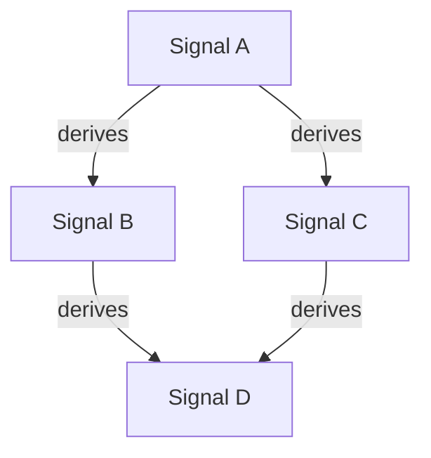
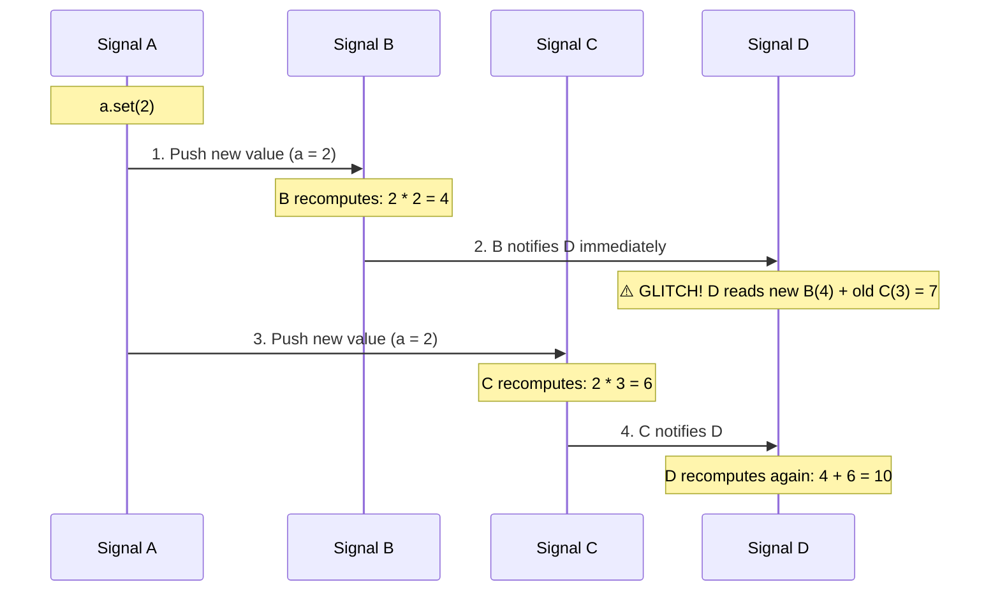
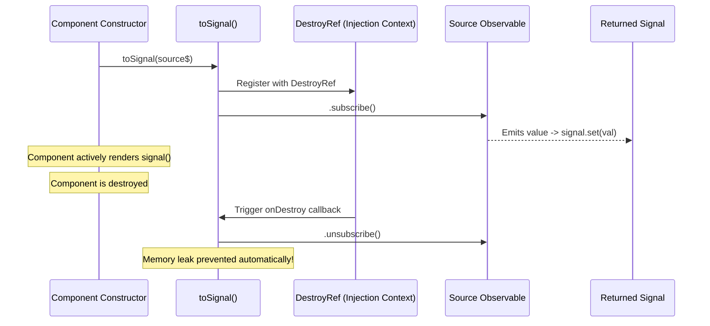
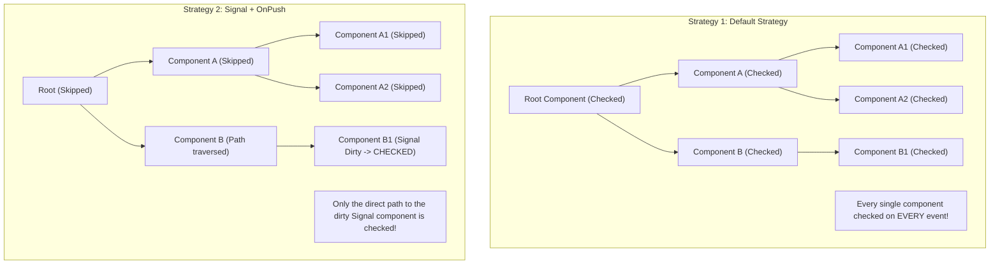

# Angular Signals — Comprehensive Interview Preparation Guide

> **Author**: worldgyan.com / Ashutosh Choubey  
> **Topic**: Angular Signals & Modern Reactivity (Angular 16, 17, 18, 19+)  
> **Target Audience**: Frontend Engineers, Senior Angular Developers, Technical Leads & Architects  

---

## 💻 Practical Code Examples in this Topic
- [`examples/signals-basics.ts`](examples/signals-basics.ts) — Writable signals, `.set()`, `.update()`, immutability
- [`examples/computed-and-dynamic-deps.ts`](examples/computed-and-dynamic-deps.ts) — `computed()`, dynamic dependencies, `untracked()`, equality functions
- [`examples/effects-and-cleanup.ts`](examples/effects-and-cleanup.ts) — `effect()`, `onCleanup()`, injection context
- [`examples/signal-component-apis.ts`](examples/signal-component-apis.ts) — `input()`, `output()`, `model()`, `viewChild()`
- [`examples/rxjs-signal-interop.ts`](examples/rxjs-signal-interop.ts) — `toSignal()`, `toObservable()`, async pipe replacement
- [`examples/change-detection-and-zoneless.ts`](examples/change-detection-and-zoneless.ts) — `ChangeDetectionStrategy.OnPush` with Signals & Zoneless bootstrap

---

## Table of Contents
1. [Core Fundamentals](#1-core-fundamentals)
2. [Writable Signals (`signal`)](#2-writable-signals)
3. [Computed Signals (`computed`)](#3-computed-signals)
4. [The Diamond Dependency Problem (Deep Dive with Diagrams)](#4-the-diamond-dependency-problem)
5. [Effects (`effect`) & Side Effects](#5-effects-and-side-effects)
6. [Advanced Signal Features & Utilities](#6-advanced-signal-features-and-utilities)
7. [Signal-Based Component APIs (`input`, `output`, `model`, `viewChild`)](#7-signal-based-component-apis)
8. [Signals vs RxJS Observables & `toSignal` Lifecycle](#8-signals-vs-rxjs-observables--tosignal-lifecycle)
9. [Change Detection Strategies (`Default` vs `OnPush`) & Signals](#9-change-detection-strategies-default-vs-onpush--signals)
10. [Zoneless Angular (Operating Without `zone.js`)](#10-zoneless-angular-operating-without-zonejs)
11. [Disadvantages & Limitations of Angular Signals](#11-disadvantages--limitations-of-angular-signals)
12. [Common Pitfalls & Anti-Patterns](#12-common-pitfalls--anti-patterns)
13. [High-Frequency Interview Questions (Q&A)](#13-high-frequency-interview-questions)

---

## 1. Core Fundamentals

### What is a Signal in Angular?
A **Signal** is a reactive wrapper around a value that notifies interested consumers when that value changes. 
Signals implement a **push-pull reactivity algorithm**:
- **Push**: When a signal value changes, it pushes a notification down the dependency graph indicating that consumers are dirty.
- **Pull**: The actual computation or DOM update only pulls (reads) the new value when it is needed.

```typescript
import { signal } from '@angular/core';

const count = signal(0);
console.log(count()); // Read the value by calling it like a getter function: 0
```

### Why did Angular introduce Signals?
1. **Fine-Grained Reactivity**: Traditional Angular checks the entire component tree (top-to-bottom) during change detection unless optimized with `OnPush`. Signals inform Angular *exactly* which template binding needs updating.
2. **Path to Zoneless Angular**: Angular historically relied on `zone.js` to monkey-patch asynchronous browser APIs (setTimeout, Promise, XHR, events) to schedule change detection. Signals allow Angular to know state changed without needing `zone.js`.
3. **Glitch-Free State**: Avoids transient inconsistent states (e.g., the diamond dependency problem).
4. **Simpler Mental Model**: Eliminates the need for manual `.unsubscribe()` calls and `async` pipes for basic synchronous component state.

---

## 2. Writable Signals

A writable signal allows direct updates to its value.

```typescript
import { signal } from '@angular/core';

// Creation
const counter = signal<number>(10);

// 1. Direct replacement via .set()
counter.set(20);

// 2. Value transformation via .update()
counter.update(current => current + 1); // 21
```

> **Note on `.mutate()`**: In early Angular 16 previews, `signal.mutate()` existed. It was **removed in Angular 17** because mutating objects in-place broke equality checks and predictable data flow. Always return new immutable references with `.update()`.

### Immutability Best Practice
```typescript
interface UserProfile {
  name: string;
  role: string;
}

const user = signal<UserProfile>({ name: 'Ashutosh', role: 'Developer' });

// Recommended: Return a new object reference
user.update(u => ({ ...u, role: 'Lead Architect' }));
```

---

## 3. Computed Signals

A **computed signal** derives its value from other signals. It is declared using the `computed()` function.

```typescript
import { signal, computed } from '@angular/core';

const price = signal(100);
const taxRate = signal(0.18);

const total = computed(() => price() * (1 + taxRate()));
console.log(total()); // 118
```

### Key Properties of `computed()`:
1. **Lazily Evaluated**: The calculation only runs when `total()` is read.
2. **Memoized**: The result is cached. Subsequent reads do not re-run the expression unless one of its dependent signals has changed.
3. **Dynamic Dependency Tracking**: Dependencies are not static. If a signal is inside an `if` branch that is skipped, it is **not** registered as a dependency.
4. **Read-Only**: Computed signals do not have `.set()` or `.update()`.

---

## 4. The Diamond Dependency Problem

The **Diamond Dependency Problem** is a foundational concept tested in Senior & Lead Angular interviews.

### The Problem Graph
Suppose Signal `A` derives `B` and `C`, and `D` is computed from both `B` and `C`:



### Concrete Code Scenario
```typescript
const a = signal(1);
const b = computed(() => a() * 2);   // b = 2
const c = computed(() => a() * 3);   // c = 3
const d = computed(() => b() + c());  // d = 2 + 3 = 5
```

Now, we update `a.set(2)`. The expected final state is:
- $b = 4$
- $c = 6$
- $d = 4 + 6 = \mathbf{10}$

### The Naive Reactive Approach (Glitch State)
In a naive push-only system (e.g. uncoordinated event listeners or reactive streams), updating `A` pushes to `B` and `C` sequentially:



#### Why is this glitch bad?
1. **Invalid Intermediate State ($d = 7$)**: For a split moment, $d$ was $7$, which is mathematically invalid for any value of $A$.
2. **Double Work & Flashing UI**: If $D$ triggers a DOM render, canvas draw, or HTTP request, the invalid state causes UI glitches and duplicate network traffic.

---

### How Angular Signals Solve It: Two-Phase Push-Pull

Angular decouples **notification** from **recomputation**:

```mermaid
graph TD
    subgraph Phase 1: Push (Mark Dirty)
        A1["a.set(2)"] -->|Mark DIRTY| B1["B marked DIRTY"]
        A1 -->|Mark DIRTY| C1["C marked DIRTY"]
        B1 -->|Mark DIRTY| D1["D marked DIRTY"]
        C1 -->|Mark DIRTY| D1
    end

    subgraph Phase 2: Pull (Topological Evaluation)
        ReadD["Consumer reads d()"] --> CheckDeps["D requests dependencies"]
        CheckDeps --> EvalB["Recompute B -> 4"]
        CheckDeps --> EvalC["Recompute C -> 6"]
        EvalB & EvalC --> EvalD["Compute D: 4 + 6 = 10 (Evaluated ONCE)"]
    end
```

1. **Mark Phase (Push)**: When `a.set(2)` runs, dirty flags propagate down to $B$, $C$, and $D$. **Zero computation runs here**.
2. **Evaluation Phase (Pull)**: When $D$ is read, it resolves dependencies in topological order. It updates $B$ to $4$, updates $C$ to $6$, and only then computes $D = 4 + 6 = 10$.
3. **Glitch-Free Guarantee**: $D$ is evaluated **exactly once**, completely glitch-free.

---

## 5. Effects and Side Effects

An `effect()` runs a side-effect whenever one or more tracked signals change.

```typescript
import { Component, signal, effect } from '@angular/core';

@Component({
  selector: 'app-counter',
  standalone: true,
  template: `<button (click)="increment()">Click {{ count() }}</button>`
})
export class CounterComponent {
  count = signal(0);

  constructor() {
    effect(() => {
      console.log(`Current count is: ${this.count()}`);
      localStorage.setItem('savedCount', this.count().toString());
    });
  }

  increment() {
    this.count.update(c => c + 1);
  }
}
```

### When to Use `effect()`:
- Logging / Analytics
- Syncing state with external non-Angular APIs (e.g., `localStorage`, WebSockets, `<canvas>`)
- Custom DOM measurements or manipulation

### When NOT to Use `effect()`:
- **Never propagate state to other signals using effects!** Use `computed()` instead.
- Writing to signals inside an `effect()` is disabled by default to prevent infinite cycles. If necessary, it requires `{ allowSignalWrites: true }`, but it is considered an anti-pattern in 99% of cases.

### Cleanup with `onCleanup`
```typescript
effect((onCleanup) => {
  const timer = setInterval(() => {
    console.log(`Tick for ${this.userId()}`);
  }, 1000);

  // Invoked before next effect run and on component destruction
  onCleanup(() => {
    clearInterval(timer);
  });
});
```

---

## 6. Advanced Signal Features and Utilities

### `untracked()`
Reads a signal's current value inside `computed` or `effect` **without** registering it as a reactive dependency:

```typescript
import { signal, computed, untracked } from '@angular/core';

const currentUser = signal('Ashutosh');
const loggingEnabled = signal(true);

const message = computed(() => {
  const user = currentUser();
  const isLogging = untracked(() => loggingEnabled());
  return `User: ${user} (Logged: ${isLogging})`;
});
```

### Custom Equality Functions
By default, signals use strict reference equality (`===`). You can customize this:

```typescript
import { signal } from '@angular/core';

interface Coordinate {
  x: number;
  y: number;
}

const point = signal<Coordinate>(
  { x: 10, y: 20 },
  {
    equal: (a, b) => a.x === b.x && a.y === b.y
  }
);

// Setting an identical coordinate object will NOT trigger consumers!
point.set({ x: 10, y: 20 });
```

---

## 7. Signal-Based Component APIs

Angular 17+ and 18+ introduced modern signal-based inputs, outputs, queries, and two-way models:

### 1. `input()` & `input.required()`
Replaces `@Input()` decorators:
```typescript
import { Component, input } from '@angular/core';

@Component({ ... })
export class UserCardComponent {
  theme = input<'light' | 'dark'>('light');
  userId = input.required<string>();
  age = input(0, { transform: (val: string | number) => Number(val) });
}
```

### 2. `output()`
Replaces `@Output() emitter = new EventEmitter()`:
```typescript
import { output } from '@angular/core';

export class ChildComponent {
  itemSelected = output<string>();

  onSelect(id: string) {
    this.itemSelected.emit(id);
  }
}
```

### 3. `model()` (Two-Way Binding)
Creates a writable signal that supports `[(value)]` banana-in-a-box syntax from parents:
```typescript
import { Component, model } from '@angular/core';

@Component({ ... })
export class ToggleComponent {
  checked = model<boolean>(false);

  toggle() {
    this.checked.update(val => !val);
  }
}
// Parent usage: <app-toggle [(checked)]="isDarkTheme" />
```

### 4. `viewChild()` and `viewChildren()`
Replaces `@ViewChild` and `@ViewChildren`:
```typescript
import { Component, viewChild, ElementRef } from '@angular/core';

@Component({ ... })
export class SearchComponent {
  searchInput = viewChild.required<ElementRef<HTMLInputElement>>('inputRef');

  focusInput() {
    this.searchInput().nativeElement.focus();
  }
}
```

---

## 8. Signals vs RxJS Observables & `toSignal` Lifecycle

| Feature | Angular Signals | RxJS Observables |
| :--- | :--- | :--- |
| **Primary Use Case** | Synchronous state management & UI bindings | Asynchronous streams, events, concurrency |
| **Values Over Time** | Always holds a current value (`T`) | Stream of multiple items over time (`0..N`) |
| **Evaluation** | Glitch-free, synchronous pull/push | Push-based, asynchronous or synchronous |
| **Memory Management** | Automatic cleanup with template / injection context | Requires explicit unsubscribe (`takeUntilDestroyed`, `async` pipe) |
| **Operators** | Simple derivation via `computed()` | Rich operator suite (`debounceTime`, `switchMap`, `catchError`) |
| **Error Handling** | Normal JavaScript try/catch | Built-in stream error channels (`catchError`) |

---

### How `toSignal` Handles RxJS Subscription Lifecycle

`toSignal()` converts an RxJS `Observable<T>` into a `Signal<T>`.



#### Key Lifecycle Mechanics:
1. **Automatic Subscription**: `toSignal` subscribes to the source Observable immediately upon creation.
2. **Automatic Teardown via `DestroyRef`**: It captures the current **injection context** and registers an `onDestroy` callback with `DestroyRef`. When the component or service is destroyed, it calls `.unsubscribe()` on the underlying subscription.
3. **Calling Outside Injection Context**: If called outside constructor or field initialization, you must provide the injector explicitly:
   ```typescript
   const posts = toSignal(posts$, { injector: this.injector });
   ```
4. **Configuration Options**:
   - `initialValue`: Specifies an initial value before the Observable emits (avoids `undefined` type).
   - `requireSync: true`: Asserts that the Observable emits synchronously upon subscription (e.g. `BehaviorSubject`). Throws a runtime error if no synchronous value is emitted.
   - `manualCleanup: true`: Prevents `toSignal` from auto-unsubscribing on destruction (useful for root singleton caches).
   - `rejectErrors: true`: Re-throws errors when reading the signal if the stream emits an error.

---

## 9. Change Detection Strategies (`Default` vs `OnPush`) & Signals

Angular offers two primary change detection strategies in components:

### 1. `ChangeDetectionStrategy.Default` (CheckAlways)
- Every time any browser event occurs (click, timer, HTTP response), Angular checks **every component in the component tree from top to bottom**.
- Even if a child component's inputs and data have not changed, its template is re-evaluated.
- Simple, but causes severe performance bottlenecks in large applications.

### 2. `ChangeDetectionStrategy.OnPush` (CheckOnce)
Angular skips checking an `OnPush` component's template unless one of these conditions is met:
1. An `@Input()` reference changed (`prev !== curr`).
2. An event handler inside the component template fired (e.g. `(click)`).
3. `ChangeDetectorRef.markForCheck()` is called manually (or automatically via `AsyncPipe`).

---

### How Signals Revolutionize `OnPush`

Historically, working with `OnPush` required boilerplate: developers had to pipe Observables through `async` pipes or inject `ChangeDetectorRef` and remember to call `cdr.markForCheck()`.

**With Signals, `OnPush` works automatically without boilerplate:**

```mermaid
graph TD
    subgraph Traditional OnPush
        Event1["External Event / Async Timer"] --> Mod1["Modify traditional variable"]
        Mod1 --> Forgotten["Forgot cdr.markForCheck()"]
        Forgotten --> NoUpdate["❌ UI DOES NOT UPDATE!"]
    end

    subgraph Signals with OnPush
        Event2["External Event / Async Timer"] --> Mod2["mySignal.set(newValue)"]
        Mod2 --> AutoMark["Signal notifies ReactiveLViewConsumer"]
        AutoMark --> InternalMark["Angular internally calls consumerMarkDirty(view)"]
        InternalMark --> UIUpdate["✅ UI UPDATES AUTOMATICALLY!"]
    end
```



#### The Internal Mechanism:
1. When a signal is read in a template (e.g. `{{ count() }}`), Angular registers that template view as a **consumer** of the signal.
2. When `count.set()` is executed, the signal notifies its consumer node.
3. Angular's internal reactive graph marks the specific component view as **dirty** (equivalent to `markForCheck()`).
4. During the next render cycle, Angular checks that component without needing any manual `ChangeDetectorRef` intervention.

---

### Visual Comparison of Change Detection Passes



---

## 10. Zoneless Angular (Operating Without `zone.js`)

### What is `zone.js` and Why Remove It?
For years, Angular relied on `zone.js` to patch all asynchronous browser APIs:
```
setTimeout, setInterval, Promise.then, fetch, XMLHttpRequest, addEventListener
```
Whenever any asynchronous operation finished, `zone.js` emitted `onMicrotaskEmpty`, which notified Angular to run `ApplicationRef.tick()` and check the entire component tree.

#### The Costs of `zone.js`:
- **Bundle Size**: Adds ~30-35KB of compressed JavaScript.
- **Overhead**: Triggers change detection even when async tasks don't touch any component state.
- **Debugging Pain**: Async stack traces are mangled with Zone internals.
- **Web Standards Conflicts**: Monkey-patching global browser APIs conflicts with emerging standards (e.g., async/await native compilation).

---

### How Signals Enable Zoneless Change Detection

In Angular 18+, you can completely remove `zone.js` by providing:

```typescript
// app.config.ts
import { ApplicationConfig, provideExperimentalZonelessChangeDetection } from '@angular/core';

export const appConfig: ApplicationConfig = {
  providers: [
    provideExperimentalZonelessChangeDetection()
  ]
};
```

### The Zoneless Architecture Comparison

```mermaid
graph TD
    subgraph Zone.js Architecture (Legacy)
        AsyncEvent["User click / setTimeout / HTTP"] --> ZoneIntercept["Zone.js intercepts async callback"]
        ZoneIntercept --> ZoneNotify["Zone onMicrotaskEmpty fires"]
        ZoneNotify --> AppTick["ApplicationRef.tick() runs"]
        AppTick --> TopDown["Checks Entire Component Tree (Top-to-Bottom)"]
    end

    subgraph Zoneless Signal Architecture (Modern)
        SigChange["mySignal.set(val)"] --> DirectNotify["Directly marks reactive view DIRTY"]
        DirectNotify --> Scheduler["Angular Scheduler queues microtask"]
        Scheduler --> TargetRender["Renders ONLY the dirty views directly!"]
    end
```

#### How Angular Detects State in Zoneless Mode:
Without `zone.js`, Angular relies on explicit notifications:
1. **Signal updates**: `signal.set()` or `signal.update()`.
2. **Component inputs changing**: Via `input()` or parent re-rendering.
3. **Template event listeners**: User clicks `(click)="doSomething()"`.
4. **Explicit notifications**: `ChangeDetectorRef.markForCheck()`.

---

## 11. Disadvantages & Limitations of Angular Signals

While Signals provide massive performance gains, a senior developer must understand their limitations:

| Limitation / Disadvantage | Explanation | How to Address |
| :--- | :--- | :--- |
| **1. Not for Asynchronous Streams** | Signals hold a single current synchronous value. They cannot handle cancellation, debounce, retry, or streaming events. | Keep using **RxJS** for async streams, websockets, and HTTP orchestration. |
| **2. Dual Reactivity Mental Model** | Having both Signals and RxJS in the same codebase creates cognitive split for developers (when to use which?). | Follow rule: **Signals for synchronous UI/state; RxJS for asynchronous event pipelines**. |
| **3. Object In-Place Mutation Trap** | Mutating an object directly (`user().name = 'x'`) does NOT trigger signals due to reference equality (`===`). | Always update immutably (`user.update(u => ({ ...u, name: 'x' }))`). |
| **4. `effect()` Infinite Loops & Race Conditions** | Writing to signals inside `effect()` can easily cause infinite loops or unpredictable microtask race conditions. | Use `computed()` for derived state. Reserve `effect()` strictly for external I/O and logging. |
| **5. Invocation Ergonomics** | Signals are getter functions (`count()`). Developers often write `{{ count }}` by mistake in templates. | Use Angular Language Service / TypeScript strict mode to catch uninvoked getters. |
| **6. Enterprise Migration Effort** | Migrating hundreds of services and `@Input()`, `@Output()` components to Signals takes time and planning. | Migrate incrementally; Signals and RxJS interop smoothly via `toSignal()` / `toObservable()`. |

---

## 12. Common Pitfalls & Anti-Patterns

1. **Mutating state in place without creating new references**:
   ```typescript
   // ❌ WRONG: Consumer signals won't trigger!
   items().push(newItem);

   // ✅ CORRECT:
   items.update(list => [...list, newItem]);
   ```

2. **Writing to signals in an effect**:
   ```typescript
   // ❌ WRONG: Causes cycle warnings and dirty-checking issues
   effect(() => {
     if (this.counter() > 10) {
       this.isTooHigh.set(true);
     }
   });

   // ✅ CORRECT:
   isTooHigh = computed(() => this.counter() > 10);
   ```

3. **Calling `effect()` outside an Injection Context**:
   ```typescript
   // ❌ WRONG: Throws NG0203 error outside constructor
   someButtonHandler() {
     effect(() => console.log(this.count()));
   }

   // ✅ CORRECT:
   private injector = inject(Injector);
   someButtonHandler() {
     runInInjectionContext(this.injector, () => {
       effect(() => console.log(this.count()));
     });
   }
   ```

---

## 13. High-Frequency Interview Questions

### Q1: What is the "Diamond Dependency Problem" and how do Signals solve it?
**Answer**:
Suppose Signal `A` derives `B` and `C`, and `D` is computed from both `B` and `C`.
In naive reactive systems, updating `A` would update `B` (triggering `D`), then update `C` (triggering `D` a second time with intermediate state). This causes temporary inconsistency (a "glitch").
Angular Signals use a **two-phase push-pull graph**:
1. **Mark Phase (Push)**: When `A` changes, dirty flags are propagated through `B`, `C`, down to `D`.
2. **Recompute Phase (Pull)**: When `D` is read, it resolves dependencies in topological order, computing `B` and `C` first, and then evaluating `D` exactly once.

### Q2: Why is `computed()` preferred over `effect()` for derived state?
**Answer**:
`computed()` is lazy, memoized, purely functional, and glitch-free. `effect()` is eager, asynchronous (scheduled as a microtask), and side-effect oriented. Deriving state via effects causes unnecessary re-renders, race conditions, and potential infinite cycles.

### Q3: When should you still use RxJS instead of Signals?
**Answer**:
Use RxJS for:
- Event streams (mouse drags, WebSocket messages)
- Complex asynchronous orchestration (`switchMap`, `mergeMap`, `concatMap`)
- Debouncing, throttling, or buffering time-based operations
- Retry policies and stream-level error handling.
Use Signals for synchronous UI state, component inputs/outputs, and template rendering.

### Q4: How does `toSignal` handle RxJS subscription lifecycles?
**Answer**:
`toSignal` automatically subscribes using the current `DestroyRef` (injection context) and un-subscribes when the enclosing component or service is destroyed. It avoids memory leaks without needing manual unsubscribe calls.

### Q5: Can we use Signals with `ChangeDetectionStrategy.OnPush`?
**Answer**:
Yes! In fact, Signals make `OnPush` effortless. Reading a signal in an `OnPush` template registers a reactive view consumer. When the signal changes, it automatically marks the view dirty (via `consumerMarkDirty()`), so the component updates without needing `ChangeDetectorRef.markForCheck()`.

### Q6: How does Zoneless Angular work without `zone.js`?
**Answer**:
Instead of `zone.js` intercepting all async browser APIs and checking the entire component tree from top to bottom, Zoneless Angular uses direct notifications from Signals, template event bindings, and input changes to schedule rendering only for the dirty views.
